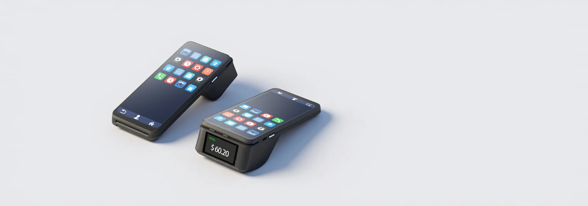
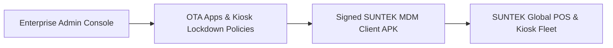

<div align="center">
  <a href="https://www.suntekai.com">
    <picture>
      <source media="(prefers-color-scheme: dark)" srcset="./assets/logo-dark.png">
      <source media="(prefers-color-scheme: light)" srcset="./assets/logo-light.png">
      
    </picture>
  </a>

  <h1>SUNTEK MDM Documentation &amp; Official Releases</h1>

  <p>
    <strong>Enterprise Mobile Device Management (MDM) Guides &amp; Verified Fleet Releases</strong> &middot; <em>Enjoy Smarter Service</em><br>
    Official deployment documentation and signed client packages by <strong>SUNTEK Technology Co., Ltd.</strong>
  </p>

  <p>
    <a href="./LICENSE"></a>
    <a href="https://github.com/SUNTEK-Official/suntek-mdm-docs/releases"></a>
    
    <a href="https://www.suntekai.com"></a>
  </p>

  
</div>

---

## Fleet Management Overview & Workflow



> [!NOTE]
> Commercial MDM server and client source code are enterprise proprietary software of **SUNTEK Technology Co., Ltd.** Public distribution includes administrator manuals, device enrollment guides, and SHA-256 verified signed APKs on GitHub Releases.

---

## Documentation Library

| Guide / Document | Format | Target Audience | Link |
| :--- | :---: | :--- | :--- |
| **Administrator Console Overview** | Markdown | Fleet Operations & IT Admins | [`docs/administrator-console-overview.md`](./docs/administrator-console-overview.md) |
| **Device Enrollment & APK Verification** | Markdown | Field Engineers & MDM Integrators | [`docs/device-enrollment-and-apk-verification.md`](./docs/device-enrollment-and-apk-verification.md) |
| **MDM Management Console Admin Guide v4.22** | PDF | Enterprise Cloud & On-Premises Admins | [`pdf/MDM-Administrator-User-Guide-v4.22.pdf`](./pdf/MDM-Administrator-User-Guide-v4.22.pdf) |
| **MDM Device Client User Manual** | PDF | Device Operators & Support Teams | [`pdf/MDM-User-Manual.pdf`](./pdf/MDM-User-Manual.pdf) |

---

## Official Signed APK Downloads

Always download signed MDM client packages from [**GitHub Releases**](https://github.com/SUNTEK-Official/suntek-mdm-docs/releases) (e.g., tag `FA8-v5.1`) and verify the `SHA-256` checksum before fleet rollout:

```bash
shasum -a 256 -c SHA256SUMS.txt
```

---

## Troubleshooting & FAQ

<details>
<summary><b>How do I obtain tenant provisioning credentials and server URLs?</b></summary>
<p>Tenant server endpoints and provisioning QR tokens are issued per enterprise account via SUNTEK Enterprise Support (<a href="mailto:support@suntekai.com">support@suntekai.com</a>).</p>
</details>

<details>
<summary><b>How can I verify MDM APK integrity prior to bulk MDM/ADB deployment?</b></summary>
<p>Always compare the downloaded APK hash against <code>SHA256SUMS.txt</code> attached to each official GitHub Release tag.</p>
</details>

---

## Support

- Enterprise Fleet Support: [support@suntekai.com](mailto:support@suntekai.com)
- Security Reports: [support@suntekai.com](mailto:support@suntekai.com)

---

<div align="center">
  
  <br><br>
  <strong>SUNTEK Technology Co., Ltd.</strong> &mdash; <em>Smart Commercial Terminal Hardware Manufacturer Since 2010</em><br>
  <sub>80+ Export Countries &middot; 5,000,000+ Terminals Shipped &middot; ISO 9001 / ISO 27001 / CE / RoHS</sub>
</div>
